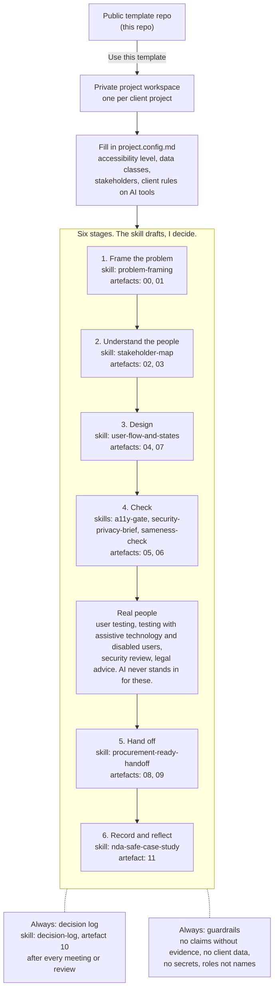

# Project set-up template

A set-up for UX and product design projects where AI is used with clear roles, written context and checks. Built for public sector and B2B work, where accessibility and security are requirements and many stakeholders have a say.

**The idea in one line:** Claude drafts, I decide, and real people test.

## Status

Built, and checked by its own validation, but **not yet used on a real project**. The skill trigger tests are written, not run. The examples are fictional, and the accessibility checks are design-stage reviews, not audits. Planning notes: [docs/important-notes.md](docs/important-notes.md).

## Best suited for

- Public sector services and B2B products, where accessibility and security are requirements
- Projects with many stakeholders or several vendors
- Complex tools with many states, or a vague request that needs framing first

Less suited to quick prototypes or solo experiments. Use a few artefacts, not the whole set.

## How it works

Each stage has skills that draft and artefacts that hold the result. More diagrams: [docs/workflow-map.md](docs/workflow-map.md). Skills by stage: [docs/skills.md](docs/skills.md).

## Quick start

1. Create a **private** workspace from this template, one per client project. Never use the client's own repo.
2. Open it in Claude Code and fill in `project.config.md`.
3. Fill in the five core artefacts: product context, problem framing, stakeholder map, requirements, decision log. You paste in raw material, Claude drafts, you correct.
4. Add other artefacts and skills when the project needs them.
5. Log decisions as they are made, and check before you share.

Full guide with example prompts: **[docs/using-this-template.md](docs/using-this-template.md)**.

## What is inside

| Path | What it holds |
|---|---|
| `AGENTS.md`, `CLAUDE.md` | Short ground rules for AI agents |
| `project.config.md` | Per-project facts: accessibility level, data, stakeholders, client rules on AI |
| `artefacts/` | Twelve fill-in templates and fictional examples |
| `design-system/` | Starter tokens, rules, an architecture guide and annotated examples |
| `.claude/` | Nine skills, and settings that block reading secrets |
| `docs/` | How I work with AI, skill catalogue, diagrams, notes |
| `evals/`, `scripts/`, `.github/` | Skill tests, and a self-check that runs on every push |

## Guardrails

- Never calls a design "accessible", "compliant" or "tested". Checks end as pass, fail or cannot tell.
- Every claim is evidence with a source, or a marked gap.
- No client data and no secrets in the repo.
- Does not replace real people: user testing, testing with disabled users, security review, legal advice.

Full rules: [AGENTS.md](AGENTS.md). The repo checks its own rules automatically.
