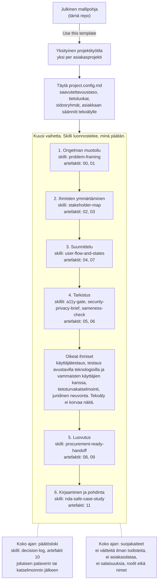

# Esittelyopas: miten tämä repo toimii ja miten sen esittelet

Tämä tiedosto on sinulle (Berit), ei tekoälylle. Se kertoo suomeksi, mitä repo sisältää, miten se toimii ja miten sen voi esitellä. Päivitä tätä aina kun repo muuttuu. Tekoäly ei lataa tätä tiedostoa oletuksena.

**Tila tällä hetkellä:** rakenteilla. Katso kohta 7, mikä on valmista ja mikä ei.

---

## 1. Hissipuhe (30 sekuntia)

> Tämä on pohja, josta aloitan jokaisen uuden suunnitteluprojektin. Se kokoaa yhteen sen, miten käytän tekoälyä työssäni: kirjallinen projektikonteksti, jonka tekoäly lukee ennen kuin se auttaa, selkeät rajat sille mitä tekoäly saa väittää, ja jäljitettävä päätösloki. Se on tehty julkisen sektorin ja B2B-projekteihin, joissa saavutettavuus ja tietoturva ovat vaatimuksia ja sidosryhmiä on monta.

Ydinajatus yhdessä lauseessa: **tekoäly luonnostelee, minä päätän, oikeat ihmiset testaavat.**

---

## 2. Mitä repo sisältää

| Kansio tai tiedosto | Mitä se on | Tila |
|---|---|---|
| `README.md` | Lyhyt esittely englanniksi: idea, prosessikaavio, pikaohje ja kansiot | valmis |
| `docs/using-this-template.md` | Täysi käyttöohje englanniksi: vaiheet, esimerkkikehotteet ja miksi artefaktit on olemassa | valmis |
| `docs/workflow-map.md` | Kolme prosessikaaviota | valmis |
| `AGENTS.md` ja `CLAUDE.md` | Tekoälyn perussäännöt. Lyhyt hakemisto (alle 100 riviä), ei pitkä sääntökirja | valmis |
| `project.config.md` | Projektin perustiedot: saavutettavuustaso, tietoluokat, kielet, sidosryhmien roolit, asiakkaan säännöt tekoälylle | valmis |
| `artefacts/` | 12 mallipohjaa (00–11) ja fiktiiviset esimerkit viidelle ydindokumentille | valmis |
| `docs/ai-workflow.md` | Miten käytän tekoälyä: roolit, rajat, istuntotavat | valmis |
| `docs/important-notes.md` | Suunnittelumuistiinpanot ja tehdyt päätökset tästä repostä | valmis |
| `.claude/settings.json` | Estosäännöt (esim. salaisuustiedostoja ei lueta). Syntaksi varmistettu Clauden dokumentaatiosta | valmis |
| `design-system/` | Design tokenit (aloitusarvot), säännöt, arkkitehtuuriohje (kerrokset, kansiorakenne, komponentin lisäämisen säännöt) ja viisi annotoitua esimerkkiä omasta työstäni: spec ennen toteutusta, päätösmerkintä joka korjaa itseään, periaatteet kompromisseineen, rehellinen rajaus, suunnittelun iteraatio | valmis. Annotaatiot ovat luonnoksia, tarkista ne |
| `.claude/skills/` | Yhdeksän omaa skilliä: ongelman muotoilu, käyttäjävirrat ja tilat, saavutettavuustarkistus (laskee kontrastin skriptillä), sidosryhmäkartta, tietoturva- ja yksityisyyskatsaus, hankintavalmis luovutus, NDA-turvallinen case study, päätösloki, samankaltaisuustarkistus | valmis, ei vielä kokeiltu oikeassa projektissa |
| `docs/skills.md` | Skillien luettelo ryhmiteltynä työnkulun kuuden vaiheen mukaan. Generoidaan skillien omista tiedoista, joten se ei vanhene. Jokaisessa vaiheessa on nyt vähintään yksi skilli, ja luettelo näyttää tyhjän vaiheen näkyvästi jos sellainen syntyy | valmis |
| `evals/` | Testikehotteet siihen, laukeavatko skillit oikein | kirjoitettu, ei vielä ajettu |
| `scripts/` ja `.github/` | Tarkistus, että repo noudattaa omia sääntöjään (AGENTS.md alle 100 riviä, skillit kunnossa, linkit toimivat, tokenien kontrastit läpi). Pyörii GitHub Actionsissa automaattisesti jokaisen pushin yhteydessä, joten säännöt eivät pääse hiljaa rikkoutumaan. Lisäksi valinnainen tokenilinteri koodiprojekteihin | valmis ja testattu |

Ydindokumentit (viisi): 00 tuotekonteksti, 01 ongelman muotoilu, 02 sidosryhmäkartta, 03 vaatimusmäärittely, 10 päätösloki. Muut lisätään vasta kun projekti niitä tarvitsee.

---

## 3. Miten repoa käytetään

Kokonaiskuva prosessista. Kaksi muuta kaaviota (yhden tehtävän kulku ja repon itsetarkistus) ovat englanniksi tiedostossa `docs/workflow-map.md`. Jos muutat työnkulkua, päivitä tämä kaavio käsin.

Tärkein asia, jonka kannattaa sanoa ääneen: **tätä repoa ei kopioida asiakkaan reposeen.**

1. Jokaiselle asiakasprojektille luodaan oma **yksityinen työtila** GitHubin "Use this template" -toiminnolla. Se on minun työtilani, ei asiakkaan koodikanta.
2. Täytän ensin `project.config.md`:n (noin 10 minuuttia).
3. Täytän viisi ydindokumenttia. Annan tekoälylle raakamateriaalin (muistiinpanot, toimeksianto), tekoäly luonnostelee ja minä korjaan. Mitä tekoäly ei löydä materiaalista, jää merkittynä aukoksi.
4. Teen suunnittelutyötä kirjoitetun kontekstin pohjalta.
5. Lisään muita dokumentteja tarpeen mukaan (esim. saavutettavuuslista, kun suunnitelmat ovat tarkistettavissa).
6. Kirjaan päätökset heti palaverin tai katselmoinnin jälkeen.
7. Ennen jakamista tarkistan saavutettavuuden, oletusvalinnat ja luottamuksellisuuden.
8. Pidän istunnot lyhyinä ja tallennan työn commiteilla.

Asiakkaalle siirretään tiedosto vain pyynnöstä, esimerkiksi päätösloki tai suunnittelujärjestelmän säännöt.

---

## 4. Miten tekoäly on mukana, ja mitä se ei tee

**Tekoäly:** luonnostelee rakenteen ja ensimmäisen version, yhdistää ja järjestää palautteen, tekee tarkistuksia sovittuja kriteerejä vasten.

**Minä:** päätän suunnan, kompromissit ja sen mitä julkaistaan.

**Oikeat ihmiset:** käyttäjätestaus, testaus avustavilla teknologioilla ja vammaisten käyttäjien kanssa, tietoturvakatselmointi, juridinen neuvonta.

Säännöt, jotka tekoälyllä on aina:

- Ei koskaan väitä suunnitelmaa "saavutettavaksi", "vaatimustenmukaiseksi" tai "testatuksi". Tulos on aina *läpi*, *hylätty* tai *ei voida päätellä suunnitelmasta*.
- Jokainen väite on merkitty *todisteeksi* (lähteellä) tai *aukoksi*.
- Ei keksittyjä käyttäjälainauksia, tutkimustuloksia tai lukuja.
- Ei asiakasdataa kehotteissa eikä repossa. Käytetään paikkamerkkejä.
- Päätökset kirjataan roolin, ei nimen, perusteella.

Nämä ovat se vastaus kysymykseen "miten voi luottaa tekoälyn tekemään työhön julkisella sektorilla".

---

## 5. Miksi se on rakennettu näin (keskeiset ratkaisut)

| Ratkaisu | Perustelu |
|---|---|
| Lyhyt `AGENTS.md` (alle 100 riviä) | Se ladataan joka kerta. Pitkä tiedosto kuluttaa tilaa ja tekoäly alkaa ohittaa sääntöjä. Harvoin tarvittavat säännöt siirretään skilleihin ja alikansioiden omiin `AGENTS.md`-tiedostoihin. |
| Esimerkit kieltolistojen sijaan | Kielletty asia jää helposti mieleen ("älä ajattele vaaleanpunaista norsua"), ja listat vanhenevat. Annotoidut hyvät esimerkit näyttävät mitä tavoitellaan. |
| Objektiiviset säännöt automatisoidaan | Tokenien käyttö ja kontrasti tarkistetaan skriptillä, ei pyydetä kehotteessa. Maku (esim. "näyttääkö geneeriseltä") tarkistetaan jälkikäteen, ei rajoiteta etukäteen. |
| Kukin skilli tekee yhden asian | Pienet skillit laukeavat oikein eivätkä kilpaile keskenään. |
| Asetukset erillään ohjeista | Projektin tiedot ovat `project.config.md`:ssä, joten samat skillit toimivat eri projekteissa. |
| Omat skillit | Kirjoitettu omasta käytännöstä ja julkisista lähteistä (WCAG 2.2, GOV.UK Service Manual, W3C WAI). Painopiste julkisen sektorin ja B2B-työn tarpeissa. |
| Yleiset standardit | `project.config.md` kertoo tason ja säädöspohjan, joten mallit eivät ole sidottuja yhteen maahan. |
| Työtila ei ole asiakkaan repo | Asiakasdata ja NDA pysyvät hallinnassa. |
| Repo tarkistaa itse itsensä (GitHub Action) | Kirjoitettu sääntö rikkoutuu helposti hiljaa: `AGENTS.md` kasvaa liian pitkäksi, skillin kuvaus estää sen latautumisen tai värimuutos pudottaa kontrastin alle rajan. Automaattinen tarkistus huomaa tämän heti, oli muutoksen tekijä minä tai Claude, eikä kenenkään tarvitse muistaa ajaa sitä. Se osoittaa myös, että säännöt on pantu täytäntöön eikä vain kirjoitettu. |

---

## 6. Esittelyn kulku

### Lyhyt versio (3 minuuttia)

1. Hissipuhe (kohta 1).
2. Avaa `README.md`: "Best suited for", prosessikaavio ja "Quick start". Täydet vaiheet ovat tiedostossa `docs/using-this-template.md`.
3. Näytä `artefacts/examples/10-decision-log.example.md`: näin jäljitettävyys näyttää käytännössä.
4. Sulje roolijaolla: tekoäly luonnostelee, minä päätän, oikeat ihmiset testaavat.

### Pitkä versio (10 minuuttia)

1. Ongelma: tekoäly tuottaa geneeristä jälkeä ilman kontekstia, eikä julkisella sektorilla voi väittää mitään ilman todisteita.
2. Rakenne: kansiot ja miksi `AGENTS.md` on lyhyt.
3. Näytä `project.config.md` ja yksi täytetty esimerkki (esim. sidosryhmäkartta: kuka päättää, missä on ristiriita).
4. Näytä `docs/ai-workflow.md`: roolitaulukko ja "missä en käytä tekoälyä".
5. Näytä `docs/skills.md` ja yksi skilli (esim. saavutettavuustarkistus: se laskee kontrastin skriptillä eikä arvaa). Näytä lopuksi, että tarkistusskripti nappaa rikotun säännön.
6. Linkitä oma työ, josta sääntöjen alkuperä näkyy: agenttiajojen katselmointinäkymä ja design system -esimerkki portfoliossa.
7. Rehellinen loppu: mitä ei vielä ole tai ei ole testattu (kohta 7).

---

## 7. Rehellisesti: mitä on ja mitä ei vielä ole

Älä esitä valmiiksi sitä, mikä ei ole valmis.

- **Valmis:** perusta (M1), mallipohjat (M2), suunnittelujärjestelmän kerros ja esimerkit (M3), skillit (M4) ja tarkistusskriptit (M5).
- **README on lyhennetty (M6):** idea, kaavio, pikaohje ja kansiot. Täysi ohje on `docs/using-this-template.md`:ssä. Ei vielä tehty: kokeilu oikeassa projektissa, trigger-testien ajaminen ja repon merkitseminen GitHubissa mallipohjaksi (Settings, Template repository), jotta "Use this template" -painike näkyy.
- **Mallipohjia ja skillejä ei ole vielä käytetty oikeassa projektissa.** Skillien laukeamista varten on testikehotteet (`evals/trigger-tests.md`), mutta niitä ei ole vielä ajettu. Sano mieluummin "ensimmäinen versio, kokeillaan seuraavassa projektissa".
- **Tarkistusskriptit on testattu**, myös tahallaan rikotulla kopiolla. Kontrastilaskuri antaa samat tulokset kuin tunnetut vertailuarvot (esim. musta valkoisella 21:1).
- **Esimerkkien annotaatiot ovat luonnoksia.** Ne on kirjoitettu lukemalla omia projektejasi, ja sinun pitää tarkistaa, että kuvaus siitä mitä päätit ja mistä luovuit pitää paikkansa.
- **Esimerkit ovat fiktiivisiä.** Ne on merkitty sellaisiksi. Älä esitä niitä oikeana asiakastyönä.
- **Esimerkit puuttuvat vielä** mallipohjille 04–09 ja 11.
- **Saavutettavuuslista on suunnitteluvaiheen tarkistus, ei auditointi.** Se ei korvaa testausta avustavilla teknologioilla eikä vammaisten käyttäjien kanssa.
- **Estosäännöt ja skillien rakenne on tarkistettu Clauden dokumentaatiosta.** Auki on vielä muun muassa `/design-sync`-toiminnon rajat ja se, ladataanko skill-kansion README tekoälyn kontekstiin (siksi sitä ei sallita). Katso `docs/important-notes.md`.

---

## 8. Todennäköisiä kysymyksiä ja vastauksia

**Eikö tekoäly vie suunnittelijan työn?**
Ei tässä mallissa. Tekoäly tekee rakenteen ja luonnokset. Päätökset, kompromissit ja vastuu ovat minulla, ja käyttäjätestaus tehdään oikeilla ihmisillä.

**Miten varmistat saavutettavuuden?**
En varmista sitä tekoälyllä. Suunnitteluvaiheessa tehdään tarkistus, jossa tulos on läpi, hylätty tai "ei voida päätellä suunnitelmasta". Varsinainen vaatimustenmukaisuus todennetaan toteutetusta tuotteesta avustavilla teknologioilla ja vammaisten käyttäjien kanssa.

**Mitä tapahtuu asiakkaan luottamukselliselle datalle?**
Ei viedä tekoälylle ilman asiakkaan lupaa. `project.config.md` kysyy asiakkaan säännöt heti alussa, ja siihen asti käytetään paikkamerkkejä. Työtila on yksityinen eikä päädy asiakkaan repoon.

**Miksi sääntöjä on niin vähän?**
Koska pitkä sääntökirja ladataan joka kerta ja se heikentää noudattamista. Rakenne on hakemisto, ja yksityiskohdat ovat vain silloin ladattuina kun niitä tarvitaan.

**Eikö tämä ole liikaa dokumentointia?**
Pienessä projektissa on. Siksi ydindokumentteja on viisi ja muut lisätään tarpeen mukaan.

**Miten tämä auttaa monen sidosryhmän projektissa?**
Sidosryhmäkartta, päätöslokki ja palautteen lokiin kirjaus tekevät näkyväksi kuka päättää, mikä on ristiriidassa ja miksi jokin ratkaisu tehtiin.

**Miksi skillit eivät ole vaiheittain omissa kansioissaan?**
Clauden dokumentaatio kuvaa vain tasaisen rakenteen (`.claude/skills/<skillin nimi>/SKILL.md`), eikä kerro tukeeko se alikansioita. Vaarana olisi, että skillit eivät lataudu. Siksi jokainen skilli kertoo vaiheensa omissa tiedoissaan (`metadata.stage`), ja `docs/skills.md` ryhmittelee ne vaiheittain. Ryhmittely on sama, mutta mikään ei rikkoudu.

---

## 9. Sanasto

| Termi | Selitys |
|---|---|
| Artefakti | Mallipohja tai täytetty dokumentti, joka vastaa yhteen projektin kysymykseen |
| `AGENTS.md` | Tiedosto, jonka tekoälyagentti lukee ohjeikseen |
| `CLAUDE.md` | Claude Coden ohjetiedosto. Tässä se vain viittaa `AGENTS.md`:hen |
| Skilli | Pieni ohjepaketti, jonka tekoäly lataa vasta kun tehtävä vastaa sen kuvausta |
| Design token | Nimetty arvo (väri, väli, koko), jonka kautta suunnittelu ja koodi puhuvat samasta asiasta |
| Päätösloki | Lyhyet numeroidut merkinnät merkittävistä päätöksistä: mitä, kuka päätti, miksi |
| Aukko (gap) | Asia, jolle ei ole todistetta. Merkitään näkyviin eikä arvata |
| Työtila | Oma yksityinen repo, joka luodaan tästä mallista yhtä projektia varten |

---

## 10. Ylläpito

Kun rakennat jotain uutta, päivitä kohdat 2 ja 7 (mikä on valmista). Jos jokin päätös muuttuu, päivitä myös `docs/important-notes.md`.
