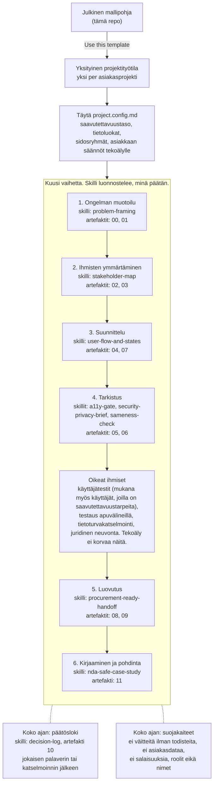

# Ohjeet suomeksi

Suomenkielinen yleiskuva: mikä tämä mallipohja on, mitä se sisältää ja miten sitä käytetään. Varsinaiset ohjeet ja tiedostot ovat englanniksi. Lyhyt esittely on [README:ssä](../README.md) ja täysi käyttöohje tiedostossa [using-this-template.md](using-this-template.md). Tekoäly ei lataa tätä tiedostoa oletuksena.

## Lyhyesti

Tämä on pohja UX- ja tuotesuunnitteluprojektien aloittamiseen. Se kokoaa yhteen tavan käyttää tekoälyä suunnittelutyössä: kirjallinen projektikonteksti, jonka tekoäly lukee ennen kuin se auttaa, selkeät rajat sille, mitä tekoäly saa väittää, ja jäljitettävä päätösloki. Pohja on tehty julkisen sektorin ja B2B-projekteihin, joissa saavutettavuus ja tietoturva ovat vaatimuksia ja sidosryhmiä on monta.

Ydinajatus: **tekoäly luonnostelee, minä päätän, oikeat ihmiset testaavat.**

## Mitä repo sisältää

| Kansio tai tiedosto | Mitä se on |
|---|---|
| `README.md` | Lyhyt esittely englanniksi: idea, prosessikaavio, pikaohje ja kansiot |
| `docs/using-this-template.md` | Täysi käyttöohje englanniksi: vaiheet, esimerkkikehotteet ja miksi artefaktit on olemassa |
| `docs/workflow-map.md` | Kolme prosessikaaviota |
| `docs/artefact-guide.md` | Jokaiselle artefaktille lukija, käyttötilanne, miten muut saavat sen ja missä totuus asuu |
| `docs/ai-workflow.md` | Miten tekoälyä käytetään: roolit, rajat ja istuntotavat |
| `docs/skills.md` | Skillien luettelo työnkulun vaiheittain. Generoidaan skillien omista tiedoista |
| `AGENTS.md`, `CLAUDE.md` | Tekoälyn perussäännöt. Lyhyt hakemisto (alle 100 riviä), ei pitkä sääntökirja |
| `project.config.md` | Projektin perustiedot: saavutettavuustaso, tietoluokat, kielet, sidosryhmien roolit, asiakkaan säännöt tekoälylle ja materiaalin säilytyspaikka |
| `artefacts/` | 12 mallipohjaa (00–11) ja fiktiiviset esimerkit viidelle ydindokumentille |
| `design-system/` | Aloitustokenit, säännöt, arkkitehtuuriohje (kerrokset, kansiorakenne, komponentin lisäämisen säännöt) ja viisi annotoitua esimerkkiä |
| `.claude/skills/` | Yhdeksän skilliä: ongelman muotoilu, sidosryhmäkartta, käyttäjävirrat ja tilat, saavutettavuustarkistus, tietoturva- ja yksityisyyskatsaus, samankaltaisuustarkistus, hankintavalmis luovutus, päätösloki ja NDA-turvallinen case study |
| `.claude/settings.json` | Estosäännöt, esimerkiksi salaisuustiedostoja ei lueta |
| `evals/` | Testikehotteet sille, laukeavatko skillit oikein |
| `scripts/`, `.github/` | Tarkistus, että repo noudattaa omia sääntöjään. Pyörii GitHub Actionsissa jokaisen pushin yhteydessä |

Viisi ydindokumenttia: 00 tuotekonteksti, 01 ongelman muotoilu, 02 sidosryhmäkartta, 03 vaatimusmäärittely ja 10 päätösloki. Muut lisätään vasta, kun projekti niitä tarvitsee.

## Miten repoa käytetään

Kokonaiskuva prosessista. Kaksi muuta kaaviota (yhden tehtävän kulku ja repon itsetarkistus) ovat englanniksi tiedostossa [workflow-map.md](workflow-map.md).

**Tärkeää: tätä repoa ei kopioida asiakkaan repoon.** Jokaiselle asiakasprojektille luodaan oma yksityinen työtila, ja asiakkaan koodikanta pysyy koskemattomana.

1. Luo GitHubissa "Use this template" -toiminnolla uusi **yksityinen** repo projektia varten.
2. Täytä `project.config.md` (noin 10 minuuttia). Kaikki muut pohjat ja skillit lukevat sen.
3. Täytä viisi ydindokumenttia. Anna tekoälylle raakamateriaali (muistiinpanot, toimeksianto), tekoäly luonnostelee ja sinä korjaat. Mitä tekoäly ei löydä materiaalista, jää merkittynä aukoksi.
4. Tee suunnittelutyötä kirjoitetun kontekstin pohjalta.
5. Lisää muita dokumentteja tarpeen mukaan, esimerkiksi saavutettavuuslista, kun suunnitelmat ovat tarkistettavissa.
6. Kirjaa päätökset heti palaverin tai katselmoinnin jälkeen.
7. Tarkista saavutettavuus, oletusvalinnat ja luottamuksellisuus ennen jakamista.
8. Pidä istunnot lyhyinä ja tallenna työ commiteilla.

Asiakkaalle toimitetaan tiedosto vain pyynnöstä tai projektin lopussa, esimerkiksi päätösloki tai suunnittelujärjestelmän säännöt.

## Tekoälyn rooli ja rajat

- **Tekoäly:** luonnostelee rakenteen ja ensimmäisen version, yhdistää ja järjestää palautteen ja tekee tarkistuksia sovittuja kriteerejä vasten.
- **Suunnittelija:** päättää suunnan, kompromissit ja sen, mitä julkaistaan.
- **Oikeat ihmiset:** käyttäjätestit (mukana myös käyttäjät, joilla on saavutettavuustarpeita), testaus apuvälineillä, tietoturvakatselmointi ja juridinen neuvonta.

Säännöt, jotka tekoälyllä on aina:

- Se ei väitä suunnitelmaa "saavutettavaksi", "vaatimustenmukaiseksi" tai "testatuksi". Tulos on aina *läpi*, *hylätty* tai *ei voida päätellä suunnitelmasta*.
- Jokainen väite on merkitty *todisteeksi* (lähteellä) tai *aukoksi*.
- Ei keksittyjä käyttäjälainauksia, tutkimustuloksia tai lukuja.
- Ei asiakasdataa kehotteissa eikä repossa. Käytetään paikkamerkkejä.
- Päätökset kirjataan roolin, ei nimen, perusteella.

Näin tekoälyn tekemän työn voi perustella myös ympäristössä, jossa jäljitettävyys on vaatimus.

## Miksi se on rakennettu näin

| Ratkaisu | Perustelu |
|---|---|
| Lyhyt `AGENTS.md` (alle 100 riviä) | Se ladataan joka kerta. Pitkä tiedosto kuluttaa tilaa, ja tekoäly alkaa ohittaa sääntöjä. Harvoin tarvittavat säännöt siirretään skilleihin ja alikansioiden omiin `AGENTS.md`-tiedostoihin. |
| Esimerkit kieltolistojen sijaan | Kielletty asia jää helposti mieleen, ja listat vanhenevat. Annotoidut hyvät esimerkit näyttävät, mitä tavoitellaan. |
| Objektiiviset säännöt automatisoidaan | Tokenien käyttö ja kontrasti tarkistetaan skriptillä, ei pyydetä kehotteessa. Maku, esimerkiksi "näyttääkö geneeriseltä", tarkistetaan jälkikäteen eikä rajoiteta etukäteen. |
| Kukin skilli tekee yhden asian | Pienet skillit laukeavat oikein eivätkä kilpaile keskenään. |
| Asetukset erillään ohjeista | Projektin tiedot ovat `project.config.md`:ssä, joten samat skillit toimivat eri projekteissa. |
| Omat skillit | Kirjoitettu omasta käytännöstä ja julkisista lähteistä (WCAG 2.2, GOV.UK Service Manual, W3C WAI). Painopiste on julkisen sektorin ja B2B-työn tarpeissa. |
| Yleiset standardit | `project.config.md` kertoo tason ja säädöspohjan, joten mallit eivät ole sidottuja yhteen maahan. |
| Työtila ei ole asiakkaan repo | Asiakasdata ja salassapito pysyvät hallinnassa. |
| Dokumenttien pääversio on Gitissä | Historia, yksi totuuden lähde ja tekoäly lukee tiedostot suoraan. Julkaistut kopiot ovat numeroituja ja päivättyjä versioita. Jira säilyy tikettityölle. |
| Repo tarkistaa itse itsensä | Kirjoitettu sääntö rikkoutuu helposti hiljaa: `AGENTS.md` kasvaa liian pitkäksi, skillin kuvaus estää sen latautumisen tai värimuutos pudottaa kontrastin alle rajan. Automaattinen tarkistus huomaa tämän heti, kuka muutoksen tekikin. |

## Tila ja rajaukset

- **Rakennettu:** perusta, 12 mallipohjaa, suunnittelujärjestelmän kerros, yhdeksän skilliä ja tarkistusskriptit. Tarkistus on testattu myös tahallaan rikotuilla kopioilla, ja kontrastilaskuri antaa samat tulokset kuin tunnetut vertailuarvot (esimerkiksi musta valkoisella 21:1).
- **Ei vielä kokeiltu oikeassa projektissa.** Skillien laukeamista varten on testikehotteet (`evals/trigger-tests.md`), mutta niitä ei ole vielä ajettu.
- **Esimerkit ovat fiktiivisiä** ja merkitty sellaisiksi. Esimerkit puuttuvat vielä pohjille 04–09 ja 11.
- **Suunnittelujärjestelmän esimerkkien annotaatiot ovat luonnoksia.** Ne perustuvat tekijän omiin projekteihin, ja tekijän pitää vahvistaa ne.
- **Saavutettavuuslista on suunnitteluvaiheen tarkistus, ei auditointi.** Se ei korvaa testausta apuvälineillä eikä käyttäjätestejä käyttäjillä, joilla on saavutettavuustarpeita.
- **Lisenssiä ei ole vielä määritelty.** Ilman lisenssiä muilla ei ole oikeutta käyttää sisältöä, vaikka repo on julkinen.
- **Estosäännöt ja skillien rakenne on tarkistettu Clauden dokumentaatiosta.** Auki on vielä muun muassa se, ladataanko skill-kansion README tekoälyn kontekstiin (siksi sitä ei sallita). Katso [important-notes.md](important-notes.md).
- **"Use this template" -painike** näkyy vain, jos repo on merkitty mallipohjaksi GitHubin asetuksissa (Settings, Template repository).

## Usein kysyttyä

**Eikö tekoäly vie suunnittelijan työn?**
Ei tässä mallissa. Tekoäly tekee rakenteen ja luonnokset. Päätökset, kompromissit ja vastuu pysyvät suunnittelijalla, ja käyttäjätestaus tehdään oikeilla ihmisillä.

**Miten saavutettavuus varmistetaan?**
Tekoäly ei varmista sitä. Suunnitteluvaiheessa tehdään tarkistus, jossa tulos on läpi, hylätty tai "ei voida päätellä suunnitelmasta". Varsinainen vaatimustenmukaisuus todennetaan toteutetusta tuotteesta apuvälineillä ja käyttäjillä, joilla on saavutettavuustarpeita.

**Mitä tapahtuu asiakkaan luottamukselliselle datalle?**
Sitä ei viedä tekoälylle ilman asiakkaan lupaa. `project.config.md` kysyy asiakkaan säännöt tekoälystä ja materiaalin säilytyspaikasta heti alussa, ja siihen asti käytetään paikkamerkkejä. Työtila on yksityinen eikä päädy asiakkaan repoon.

**Miksi sääntöjä on niin vähän?**
Pitkä sääntökirja ladataan joka kerta, ja se heikentää noudattamista. Rakenne on hakemisto, ja yksityiskohdat ladataan vain silloin, kun niitä tarvitaan.

**Eikö tämä ole liikaa dokumentointia?**
Pienessä projektissa on. Siksi ydindokumentteja on viisi ja muut lisätään tarpeen mukaan. Jokaisella artefaktilla on nimetty lukija ja käyttö ([artefact-guide.md](artefact-guide.md)), ja jos niitä ei voi nimetä, artefaktia ei tehdä. Dokumenttien pääversio on työtilassa (yksityinen Git), ja julkaistut kopiot ovat numeroituja ja päivättyjä versioita, ja uusi versio viedään asiakkaalle aina, kun dokumentti muuttuu. Jos asiakas haluaa ylläpitää jotain dokumenttia itse, sovitaan alussa, että heidän versionsa on siitä lähtien alkuperäinen. Jira säilyy tikettityölle. Jos asiakas ei salli materiaalin säilytystä GitHubissa, materiaali pidetään heidän omissa järjestelmissään, ja projektin lopussa lopulliset versiot luovutetaan heille.

**Miten tämä auttaa monen sidosryhmän projektissa?**
Sidosryhmäkartta, päätösloki ja palautteen kirjaus tekevät näkyväksi, kuka päättää, mistä oltiin eri mieltä ja miksi jokin ratkaisu tehtiin.

**Miksi skillit eivät ole vaiheittain omissa kansioissaan?**
Clauden dokumentaatio kuvaa vain tasaisen rakenteen (`.claude/skills/<skillin nimi>/SKILL.md`), eikä se kerro, tukeeko se alikansioita. Vaarana olisi, etteivät skillit lataudu. Siksi jokainen skilli kertoo vaiheensa omissa tiedoissaan (`metadata.stage`), ja [skills.md](skills.md) ryhmittelee ne vaiheittain.

## Sanasto

| Termi | Selitys |
|---|---|
| Artefakti | Mallipohja tai täytetty dokumentti, joka vastaa yhteen projektin kysymykseen |
| `AGENTS.md` | Tiedosto, jonka tekoälyagentti lukee ohjeikseen |
| `CLAUDE.md` | Claude Coden ohjetiedosto. Tässä se vain viittaa `AGENTS.md`:hen |
| Skilli | Pieni ohjepaketti, jonka tekoäly lataa vasta, kun tehtävä vastaa sen kuvausta |
| Design token | Nimetty arvo (väri, väli, koko), jonka kautta suunnittelu ja koodi puhuvat samasta asiasta |
| Päätösloki | Lyhyet numeroidut merkinnät merkittävistä päätöksistä: mitä, kuka päätti ja miksi |
| Aukko (gap) | Asia, jolle ei ole todistetta. Se merkitään näkyviin eikä arvata |
| Työtila | Oma yksityinen repo, joka luodaan tästä mallista yhtä projektia varten |

## Tämän tiedoston ylläpito

Kun repo muuttuu, päivitä kohdat "Mitä repo sisältää" ja "Tila ja rajaukset". Kaavio kohdassa "Miten repoa käytetään" on suomenkielinen kopio tiedoston [workflow-map.md](workflow-map.md) ensimmäisestä kaaviosta, ja se päivitetään käsin. Jos jokin päätös muuttuu, päivitä myös [important-notes.md](important-notes.md).
