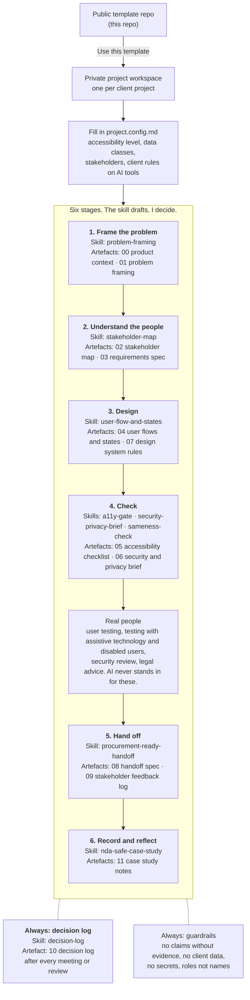
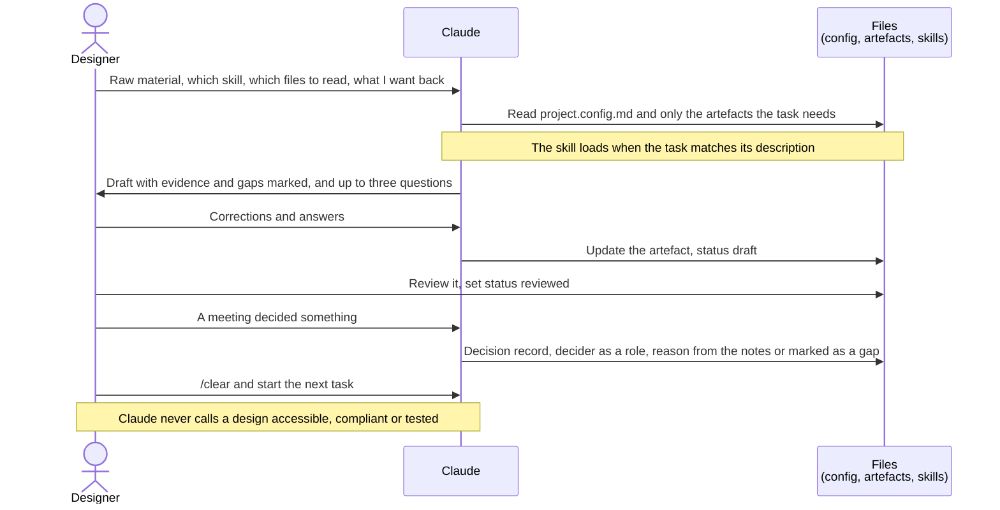
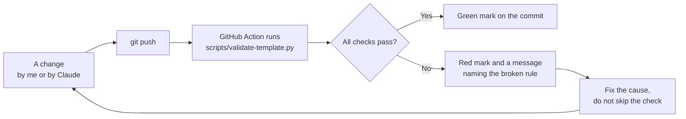

# Workflow map

Three diagrams that explain how the package works. GitHub draws them from the text below.

## 1. The whole process

From the public template to a finished case study. The six stages are the same ones in [skills.md](skills.md). Dashed lines show what runs alongside.

## 2. What happens in one task

The same loop repeats for every artefact. Claude proposes, the designer decides.

## 3. How the repo keeps its own rules

Why a rule written in a file stays true.

What the check covers: `AGENTS.md` length, skill frontmatter and length, a "do not use for" line in every skill description, no stray README in skill folders, a "Done when" section in every artefact, working links, valid stage names, an up-to-date skill catalogue, and contrast of every token colour pair. Run it yourself with `python3 scripts/validate-template.py`.
